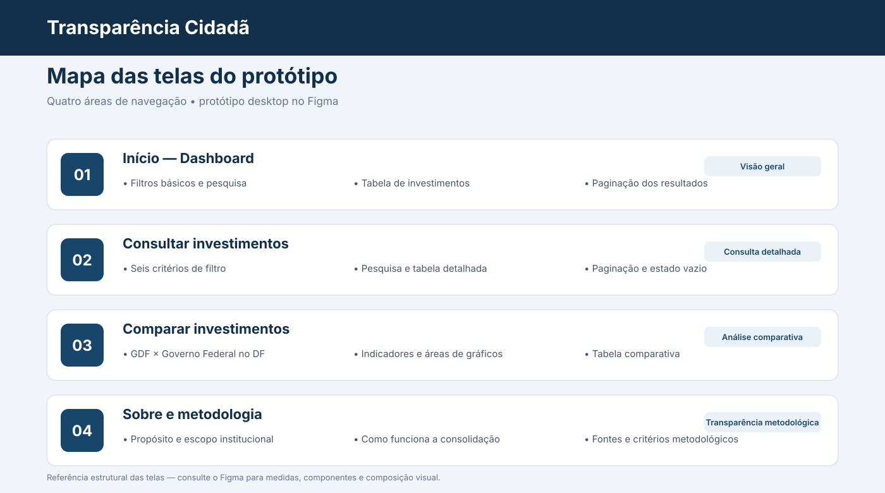

# Transparência Cidadã

**Acompanhamento de investimentos públicos no Distrito Federal**

Protótipo de uma plataforma para consulta e acompanhamento de investimentos realizados pelo Governo do Distrito Federal (GDF) e pelo Governo Federal no Distrito Federal.

> **Estado atual:** as quatro telas desktop do protótipo visual foram construídas no Figma. O repositório contém a documentação do projeto e a captura PNG já exportada do Dashboard. A implementação em HTML/CSS/JavaScript e a integração com fontes de dados ainda não foram iniciadas.

## Objetivo

Facilitar a consulta pública de informações sobre investimentos realizados no Distrito Federal, permitindo localizar registros, acompanhar valores previstos e executados e comparar recortes de investimentos do GDF e do Governo Federal.

## Escopo do produto

O protótipo está organizado em quatro telas:

1. **Início — Dashboard:** apresentação do painel, filtros básicos, pesquisa, tabela de registros e paginação.
2. **Consultar investimentos:** consulta detalhada, com filtros adicionais por região administrativa e situação.
3. **Comparar investimentos:** comparação por período, região e tipo, indicadores-resumo, áreas de gráficos e tabela comparativa.
4. **Sobre e metodologia:** objetivo, escopo institucional, funcionamento da consulta, metodologia e fontes de dados previstas.

## Protótipo no Figma

**[Abrir o arquivo Prototipo_Projeto_Web](https://www.figma.com/design/KB6jSOOuxBwaP17SqW903c/Prototipo_Projeto_Web)**

| Tela | Frame no Figma |
|---|---|
| 01 — Dashboard | [Dashboard — Desktop](https://www.figma.com/design/KB6jSOOuxBwaP17SqW903c/Prototipo_Projeto_Web?node-id=54-162) |
| 02 — Consultar | [Consultar — Desktop](https://www.figma.com/design/KB6jSOOuxBwaP17SqW903c/Prototipo_Projeto_Web?node-id=18-5) |
| 03 — Comparar | [Comparar — Desktop](https://www.figma.com/design/KB6jSOOuxBwaP17SqW903c/Prototipo_Projeto_Web?node-id=61-2) |
| 04 — Sobre | [Sobre — Desktop](https://www.figma.com/design/KB6jSOOuxBwaP17SqW903c/Prototipo_Projeto_Web?node-id=63-11) |

### Visão geral das telas



### Captura do Dashboard


> A captura PNG acima é a exportação visual do Dashboard já armazenada no repositório. Para consultar as telas 02, 03 e 04, utilize os links diretos dos frames no Figma. A exportação das novas capturas ainda deverá ser adicionada à pasta `docs/imagens/`.

## Estrutura do repositório

```text
transparencia-cidada/
├── README.md
├── design/
│   └── prototipo-figma.md
├── docs/
│   ├── imagens/
│   │   ├── Dashboard - Desktop.png
│   │   └── Mapa-das-telas.svg
│   ├── implementacao-programadores.md
│   ├── paginas.md
│   └── planejamento.md
└── src/
    └── (implementação a iniciar)
```

## Estado de desenvolvimento

| Entrega | Situação |
|---|---|
| Protótipo visual do Dashboard | Concluído |
| Protótipo visual de Consultar | Concluído |
| Protótipo visual de Comparar | Concluído |
| Protótipo visual de Sobre | Concluído |
| Documentação para desenvolvimento | Publicada neste repositório |
| Exportação PNG das telas 02–04 | Pendente |
| Implementação HTML/CSS/JavaScript | A iniciar |
| Integração com fontes de dados | A definir |
| Testes funcionais, acessibilidade e responsividade | Pendentes |

## Orientações para implementação

O Figma é a referência visual. A especificação inicial de cada tela, os campos e as regras que precisam ser discutidas estão em [docs/implementacao-programadores.md](docs/implementacao-programadores.md).

**Importante:** textos e valores de exemplo, traços e cartões sem dados são placeholders do protótipo. Não representam registros oficiais. Nenhum valor financeiro deve ser exibido como real antes da integração e validação da respectiva fonte.

## Contribuição

As decisões de interface devem ser registradas no Figma e as alterações de código versionadas neste repositório. Recomenda-se organizar tarefas por tela e funcionalidade no GitHub Projects e submeter mudanças para revisão antes da integração à branch principal.

## Licença

A definir.
